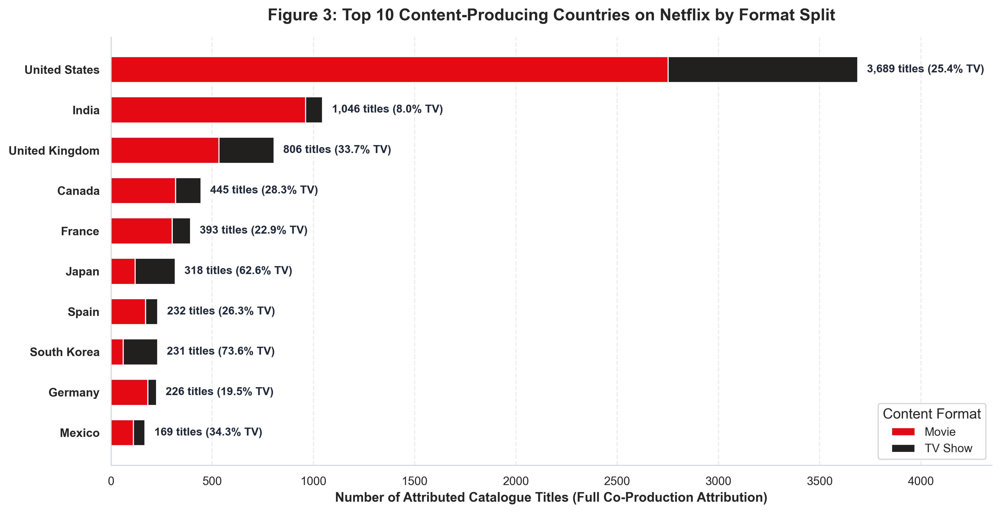
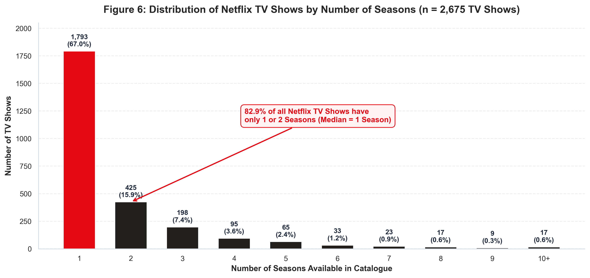

# Netflix Content Analytics
### Exploratory Data Analysis of Global Streaming Content

**Author:** David Olukayode  
**Role:** AI & ML Engineer | Applied Research | Trustworthy AI

---

## 1. Project Overview

Subscription video-on-demand (SVOD) platforms manage global content libraries spanning thousands of feature films, limited series, and multi-season television shows across regional markets and maturity tiers.

This repository contains an Exploratory Data Analysis (EDA) of the **Netflix Movies and TV Shows** catalogue dataset (`netflix_titles.csv`, $N = 8,807$ raw records; $N = 8,803$ unique deduplicated titles). The analysis is structured into six technical stages:

1. **Data Acquisition & Schema Profiling:** Environment-aware path resolution supporting local repository execution and hosted Kaggle Kernels, paired with heap memory profiling.
2. **Data Quality Assessment:** Missing-value mechanism analysis (MAR vs. MCAR), exact and normalized string deduplication (handling trailing non-breaking spaces `\xa0` and casing differences), cross-column schema checks, and date validation.
3. **Data Cleaning & Feature Engineering:** Recovery of misplaced duration records, temporal feature extraction (`year_added`, `month_added`, `acquisition_lag`), rating standardization (`maturity_tier`), and First Normal Form (1NF) tokenization of multi-label country and genre attributes.
4. **Univariate Distributional Analysis:** Parametric ($\bar{x}$, $s$) and non-parametric ($Q_2$, $\text{IQR}$, Tukey fences) summaries of format composition, production release years, runtimes, season counts, ratings, geographies, and genres.
5. **Bivariate & Multivariate Cross-Tabulation:** Contingency tables examining format specialization by country, acquisition lag by format, row-normalized country-by-genre distributions, and runtime distributions across genres.
6. **Statistical Visualization & Reporting:** 12 `300 DPI` figures paired with quantitative interpretations and scope limitations.

---

## 2. Scope & Methodological Distinctions

Two distinctions govern the interpretation of this dataset:
* **Catalogue Supply vs. Audience Demand:** This dataset records **supply-side catalogue metadata** (what titles are available in the library). It contains **no viewership telemetry** (no viewing hours, completion rates, retention, or revenue). High frequency of a genre or rating category reflects catalogue supply, not audience demand.
* **Production Release Year (`release_year`) vs. Platform Addition Date (`date_added`):**
  * `release_year` records when a movie or series originally premiered (1925-2021).
  * `date_added` records when Netflix added the title to its catalogue (2008-September 25, 2021).
  * Their difference (`acquisition_lag = year_added - release_year`) distinguishes same-year releases from older licensed back-catalogue titles.

---

## 3. Research Questions & Methods

| No. | Research Question | Analytical Method | Section & Figures |
| :- | :--- | :--- | :--- |
| **RQ01** | What is the format composition of Netflix's catalogue? | Frequency distribution & relative proportions | Section 6A, Figure 1 |
| **RQ02** | Which countries contribute the most titles, and how does format split vary by country? | Multi-label tokenization, GroupBy aggregation & cross-tabulation | Section 6C, 7.1, Figure 3 |
| **RQ03** | What are the most common genres overall and within each content format? | Multi-label explosion & format-stratified frequency analysis | Section 6D, Figure 4, Figure 10 |
| **RQ04** | How has content addition changed over time compared to original production years? | Time-series aggregation, month-year seasonality heatmaps & acquisition lag analysis | Section 6B, 6H, 7.2, Figure 2, Figure 8, Figure 12 |
| **RQ05** | How do movie durations and TV show season counts vary, and what outliers exist? | Parametric & non-parametric distributional analysis (Mean, SD, Median, IQR, Tukey $1.5\times\text{IQR}$ fences) | Section 6F, 6G, 7.4, Figure 5, Figure 6 |
| **RQ06** | How do content maturity ratings differ between Movies and TV Shows? | Column-normalized contingency tables & unified maturity tier mapping | Section 6E, Figure 7, Figure 9 |
| **RQ07** | Which country-by-genre combinations dominate key production hubs? | Multivariate join & row-normalized contingency matrix | Section 7.3, Figure 11 |

---

## 4. Dataset Source

* **Dataset:** Netflix Movies and TV Shows ([`shivamb/netflix-shows`](https://www.kaggle.com/datasets/shivamb/netflix-shows))
* **License:** CC0: Public Domain (`CC0-1.0`)
* **Primary File:** `netflix_titles.csv` ($8,807$ rows $\times$ $12$ columns; $7.79\text{ MB}$ deep heap memory usage)
* **Coverage:** Catalogue additions through **September 25, 2021**; release years spanning **1925-2021**.

---

## 5. Technical Stack

* **Language:** Python 3 (`>=3.10`, tested on Python `3.13.7`)
* **Data Manipulation:** `pandas`, `numpy`
* **Visualization:** `matplotlib`, `seaborn`
* **Notebook & Web UI:** Jupyter Notebook (`nbformat`, `nbclient`, `ipykernel`), `streamlit` (optional local UI)

---

## 6. Repository Structure

```text
netflix-content-analytics/
│
├── README.md                           # Project documentation and summary of findings
├── netflix_content_analytics.ipynb     # Executed Jupyter Notebook (Sections 1-11)
├── app.py                              # Local Streamlit UI for exploring charts and tables
├── requirements.txt                    # Python package dependencies
├── .gitignore                          # Excludes raw data and local artifacts
│
├── data/
│   └── README.md                       # Dataset download and path configuration instructions
│
└── visuals/
    ├── README.md                       # Index of exported 300-DPI figures
    ├── 01_catalogue_composition.png
    ├── 02_release_year_distribution.png
    ├── 03_top_10_countries.png
    ├── 04_top_10_genres.png
    ├── 05_movie_duration_distribution.png
    ├── 06_tv_show_season_distribution.png
    ├── 07_content_rating_distribution.png
    ├── 08_yearly_content_addition_trends.png
    ├── 09_content_ratings_by_type.png
    ├── 10_genre_comparisons_by_type.png
    ├── 11_country_genre_heatmap.png
    └── 12_acquisition_lag_distribution.png
```

---

## 7. Setup & Execution

### 7.1 Clone Repository & Install Dependencies

```bash
git clone https://github.com/DavidDeez/netflix-content-analytics.git
cd netflix-content-analytics

python -m venv .venv
# Windows PowerShell:
.\.venv\Scripts\Activate.ps1
# macOS / Linux:
source .venv/bin/activate

pip install -r requirements.txt
```

### 7.2 Download Dataset

Download `netflix_titles.csv` into `./data/netflix_titles.csv` via the Kaggle CLI (or manually from Kaggle; see [`data/README.md`](./data/README.md)):

```bash
kaggle datasets download -d shivamb/netflix-shows -p ./data --unzip
```

### 7.3 Run the Notebook or Local Dashboard

```bash
# Open in Jupyter Notebook:
jupyter notebook netflix_content_analytics.ipynb

# Re-execute all cells headlessly from the command line:
jupyter nbconvert --to notebook --execute --inplace netflix_content_analytics.ipynb

# Launch the optional Streamlit web UI on http://localhost:8501:
streamlit run app.py
```

---

## 8. Key Findings

1. **Catalogue Composition (RQ01):** Across $8,803$ unique titles, Movies account for **$6,128$ titles ($69.61\%$)** and TV Shows account for **$2,675$ titles ($30.39\%$)**, a $2.29 : 1$ ratio. TV Shows increased as a share of annual additions between 2018 ($25.0\%$) and 2021 ($33.7\%$).
2. **Data Quality & Missingness Structure:** All **3 missing `duration` values** (`s5542`, `s5795`, `s5814`) were caused by runtime strings (`"74 min"`, `"84 min"`, `"66 min"`) shifted into the `rating` column; restoring them yields **100.0% completeness in `duration`**. Additionally, `director` is missing in **$91.41\%$ of TV Shows** vs. **$3.07\%$ of Movies**, confirming an MAR mechanism conditioned on content type where listwise deletion (`dropna()`) would eliminate most television series.
3. **Normalized Deduplication:** While exact row deduplication returns `0`, stripping trailing non-breaking spaces (`\xa0` in `s6530` *Consequences*) and normalizing title casing identifies **4 duplicate `(title, type)` pairs** (*Consequences*, *Esperando la carroza*, *Love in a Puff*, and *Sin senos sí hay paraíso*), reducing the sample from $8,807$ to $8,803$ unique titles.
4. **Geographic Concentration & Format Split (RQ02):** Across $7,972$ geo-tagged titles ($122$ unique countries; $16.55\%$ multi-country co-productions), the **United States ($3,689$ credits, $46.27\%$)**, **India ($1,046$, $13.12\%$)**, and the **United Kingdom ($806$, $10.11\%$)** lead production. Format allocation varies sharply by region: **India is $92.0\%$ Movies ($8.0\%$ TV Shows)**, whereas **South Korea ($73.6\%$ TV Shows)** and **Japan ($62.6\%$ TV Shows)** primarily contribute serialized television.
5. **Genre Representation (RQ03):** Across $19,315$ exploded genre tags ($42$ unique categories; mean $2.19$ tags/title), the most frequent tags are `International Movies` (**$2,749$ titles, $31.2\%$**), `Dramas` (**$2,425$, $27.5\%$**), `Comedies` (**$1,672$, $19.0\%$**), `International TV Shows` (**$1,350$, $15.3\%$**), and `Documentaries` (**$869$, $9.9\%$**). Within each format, international tags appear on **$44.9\%$ of Movies** and **$50.5\%$ of TV Shows**.
6. **Addition Velocity (RQ04):** Annual catalogue additions rose from **$82$ titles in 2015** to **$2,016$ titles in 2019** ($1,424$ Movies, $592$ TV Shows). When total additions decreased in 2020 ($1,879$ titles), Movie additions fell ($1,424 \rightarrow 1,284$) while **TV Show additions reached $595$ titles**.
7. **Release Year Concentration:** Although release years span **1925-2021**, **$84.85\%$** of all catalogue titles were released in **2010 or later**, and **$62.08\%$** were released in **2015 or later** (median Movie release year $= 2017$; median TV Show release year $= 2018$).
8. **Acquisition Lag (`year_added - release_year`):** **$51.98\%$ of TV Shows** are added to Netflix in the same calendar year they premiere ($\text{median lag} = 0.0$ years, $\text{mean} = 2.31$ years), compared to **$30.40\%$ of Movies** ($\text{median lag} = 2.0$ years, $\text{mean} = 5.73$ years). Conversely, **$29.12\%$ of Movies** are added $6+$ years after theatrical release (vs. $12.67\%$ of TV Shows).
9. **Movie Runtimes (RQ05):** Movie runtimes ($n = 6,128$) have a **mean of $99.56$ minutes** ($\text{SD} = 28.30$), a **median of $98.0$ minutes**, and an **IQR of $27.0$ minutes ($87-114$ min)**. Tukey $1.5\times\text{IQR}$ fences flag **$249$ short outliers ($<46.5$ min)** and **$201$ long outliers ($>154.5$ min)**. By genre, `Classic Movies` ($\text{median} = 112$ min) and `International Movies` ($\text{median} = 107$ min) run substantially longer than `Stand-Up Comedy` ($\text{median} = 62$ min).
10. **TV Show Seasons & Maturity Ratings (RQ05, RQ06):** **$67.03\%$ ($1,793$)** of Netflix TV Shows have **1 Season**, and **$82.92\%$ ($2,218$)** have **$\le 2$ Seasons**. For ratings, `TV-MA` ($36.40\%$) and `TV-14` ($24.54\%$) represent $60.93\%$ of the catalogue. Mapping MPAA film ratings (`R`, `PG-13`, `PG`, `G`) and TV Parental Guidelines to unified maturity tiers shows that **$75.61\%$** of titles target Mature Adults ($45.51\%$) or Teens ($30.10\%$), while **TV Shows allocate a larger share to Kids & Family ($29.50\%$) than Movies ($20.71\%$)**.

---

## 9. Figures

All 12 figures are exported at `300 DPI` into [`visuals/`](./visuals/):

### Catalogue Composition & Country Format Split



### Content Additions & Acquisition Lag


### Runtime & Season Distributions



### Maturity Ratings & Country-Genre Matrix


---

## 10. Limitations

1. **No Viewership or Engagement Data:** The dataset records catalogue supply (title counts), not viewing hours, completion rates, or subscriber retention.
2. **Static Snapshot & Survivorship Bias:** Captured in September 2021, the dataset excludes titles whose licensing windows expired before the snapshot date.
3. **Partial 2021 Year:** Observations end on September 25, 2021 (~8.8 months), omitting Q4 2021 additions.
4. **Multi-Country Attribution & Missing Country Metadata:** $9.44\%$ ($831$) of titles lack country tags, and co-productions ($16.55\%$ of geo-tagged titles) credit each listed country equally without budget weighting.
5. **Unit Inequivalence (`1 Movie` vs. `1 TV Show`):** Without episode counts and episode runtimes, title counts underestimate the share of total content hours represented by multi-season TV series.

---

## 11. Follow-Up Work

* **Episode-Level Runtime Enrichment:** Join `netflix_titles` with TMDB/IMDb metadata to compute total content hours across TV Shows and separate Netflix Originals from licensed titles.
* **Supply vs. Viewership Comparison:** Join these catalogue baselines with Netflix's *What We Watched* engagement reports to compare title supply against hours viewed across genres and countries.

---

## 12. Author

**David Olukayode**  
AI & ML Engineer | Applied Research | Trustworthy AI
