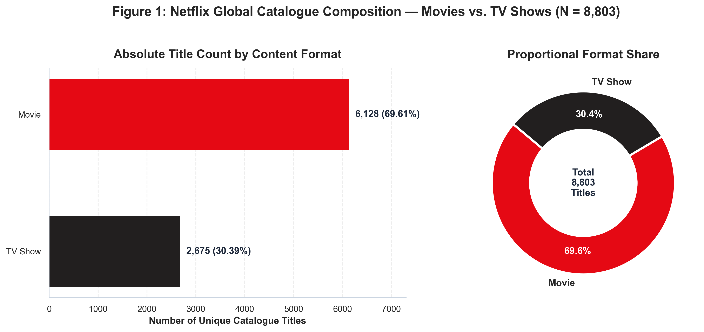
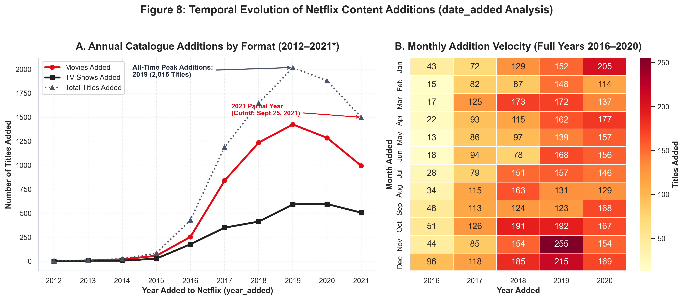
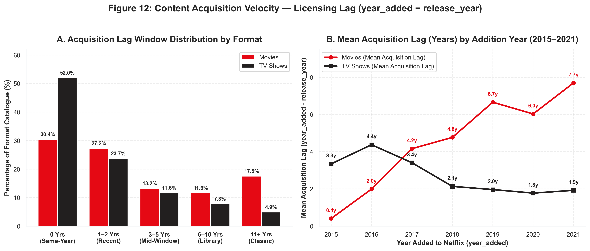
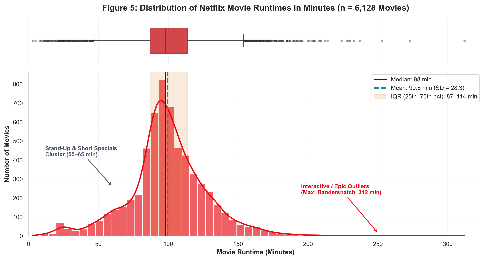
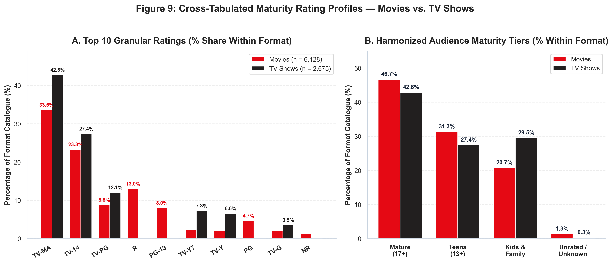
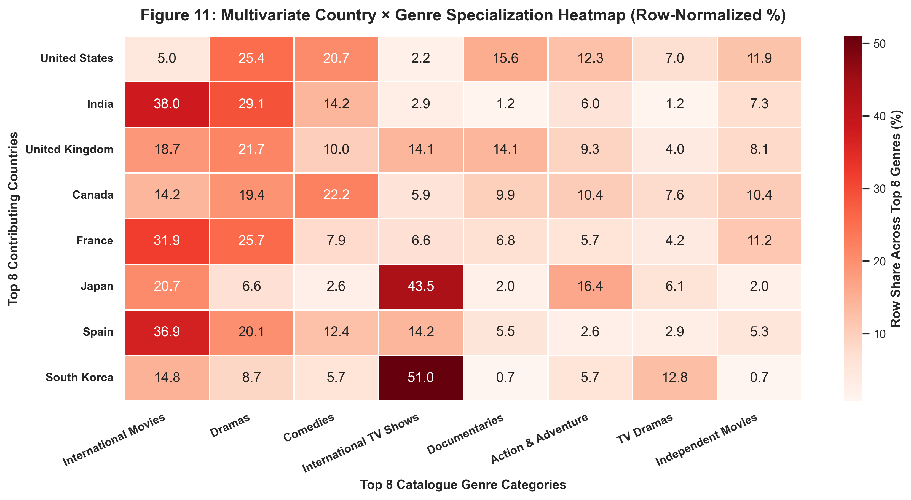

# Netflix Content Analytics
### An Exploratory Data Analysis of Global Streaming Content

**Author:** David Olukayode  
**Role / Identity:** AI & ML Engineer | Applied Research | Trustworthy AI  
**Status:** Publication-Ready Portfolio Project (Kaggle & GitHub)

---

## 1. Project Overview

Modern subscription video-on-demand (SVOD) platforms manage complex global content libraries spanning thousands of feature films, limited series, and multi-season television shows across diverse regional markets and audience maturity tiers.

This repository presents a rigorous, reproducible **Exploratory Data Analysis (EDA)** of the **Netflix Movies and TV Shows** catalogue dataset (`netflix_titles.csv`, $N = 8,807$ raw records; $N = 8,803$ unique deduplicated titles). Rather than producing an ad-hoc collection of surface-level charts, this study executes a six-stage analytical engineering workflow:

1. **Data Acquisition & Schema Profiling:** Automated environment-aware path resolution supporting both local repository execution and hosted Kaggle Kernels, accompanied by deep heap memory profiling.
2. **Forensic Data Quality Assessment:** Stratified missing-value mechanism auditing (MAR vs. MCAR), exact and normalized string deduplication (catching trailing non-breaking spaces `\xa0` and casing drift), cross-column schema contamination discovery, and temporal consistency checks.
3. **Justified Data Cleaning & Feature Engineering:** Recovery of misplaced duration records, temporal feature extraction (`year_added`, `month_added`, `acquisition_lag`), regulatory rating harmonization (`maturity_tier`), and First Normal Form (1NF) tokenization of multi-label country and genre attributes.
4. **Univariate Distributional Analysis:** Parametric ($\bar{x}$, $s$) and non-parametric ($Q_2$, $\text{IQR}$, Tukey outlier fences) investigation of format composition, production release years, runtimes, season counts, ratings, geographies, and genres.
5. **Bivariate & Multivariate Cross-Tabulation:** Conditional probability contingency matrices examining format specialization by country, acquisition lag velocity by format, row-normalized country-by-genre specialization, and runtime stratification across genres.
6. **Publication-Grade Visual Analytics & Evidence-Based Reporting:** 12 high-resolution (`300 DPI`) statistical figures paired with structured analytical interpretations and explicit methodological boundaries.

---

## 2. Problem Statement & Core Epistemological Distinctions

> *"Examine Netflix's content catalogue and identify meaningful structural, geographical, and temporal patterns that explain how the library has evolved and how content supply is distributed across formats, regional markets, genres, and maturity segments."*

Two foundational methodological distinctions govern every conclusion in this repository:
* **Catalogue Supply vs. Audience Demand:** This dataset captures **supply-side catalogue metadata** (what titles are available in the library). It contains **no demand-side viewership telemetry** (no viewing hours, completion rates, subscriber retention, or revenue). High prevalence of a genre or rating category reflects **catalogue representation and licensing priority**, never conflated with audience popularity.
* **Production Vintage (`release_year`) vs. Platform Ingestion (`date_added`):**
  * `release_year` records when a movie or series originally premiered (1925–2021).
  * `date_added` records when Netflix added the title to its streaming platform (2008–September 25, 2021).
  * Their difference—engineered as **`acquisition_lag = year_added - release_year`**—distinguishes contemporary/same-year releases from older licensed back-catalogue acquisitions.

---

## 3. Research Questions & Analytical Methods

| No. | Research Question | Analytical Method | Notebook Section & Visuals |
| :- | :--- | :--- | :--- |
| **RQ01** | What is the format composition of Netflix's catalogue? | Frequency distribution & relative proportions | Section 6A · Figure 1 |
| **RQ02** | Which countries contribute the most titles, and how does format strategy vary by country? | Multi-label tokenization, GroupBy aggregation & cross-tabulation | Section 6C, 7.1 · Figure 3 |
| **RQ03** | What are the most common genres overall and within each content format? | Multi-label explosion & format-stratified frequency analysis | Section 6D · Figure 4, Figure 10 |
| **RQ04** | How has content addition changed over time compared to original production years? | Time-series aggregation, month-year seasonality heatmaps & acquisition lag analysis | Section 6B, 6H, 7.2 · Figure 2, Figure 8, Figure 12 |
| **RQ05** | How do movie durations and TV show season counts vary, and what outliers exist? | Parametric & non-parametric distributional analysis (Mean, SD, Median, IQR, Tukey $1.5\times\text{IQR}$ fences) | Section 6F, 6G, 7.4 · Figure 5, Figure 6 |
| **RQ06** | How do content maturity ratings differ between Movies and TV Shows? | Column-normalized contingency tables & unified Audience Maturity Tier harmonization | Section 6E · Figure 7, Figure 9 |
| **RQ07** | Which country-by-genre categories are most represented across key production hubs? | Multivariate join & row-normalized specialization matrix | Section 7.3 · Figure 11 |

---

## 4. Dataset Source & Attribution

* **Dataset Title:** Netflix Movies and TV Shows
* **Curator / Source:** Shivam Bansal on Kaggle ([`shivamb/netflix-shows`](https://www.kaggle.com/datasets/shivamb/netflix-shows))
* **License:** CC0: Public Domain (`CC0-1.0`)
* **Primary File:** `netflix_titles.csv` ($8,807$ rows $\times$ $12$ columns; $7.79\text{ MB}$ in-memory heap footprint)
* **Temporal Coverage:** Catalogue additions through **September 25, 2021**; original release years spanning **1925–2021**.

---

## 5. Technologies Used

* **Programming Language:** Python 3 (`>=3.10`, validated on Python `3.13.7`)
* **Data Manipulation & Wrangling:** `pandas`, `numpy`
* **Statistical Visualization:** `matplotlib`, `seaborn`
* **Interactive Computing & Validation:** Jupyter Notebook (`nbformat`, `nbclient`, `ipykernel`)

---

## 6. Project Architecture

```text
netflix-content-analytics/
│
├── README.md                           # Comprehensive project documentation & executive report
├── netflix_content_analytics.ipynb     # Fully executed, publication-ready Jupyter Notebook (11 sections)
├── requirements.txt                    # Reproducible Python dependencies
├── .gitignore                          # Git ignore rules excluding raw data & environment artifacts
│
├── data/
│   └── README.md                       # Dataset download instructions & configurable path resolution guide
│
└── visuals/
    ├── README.md                       # Index of exported 300-DPI publication figures
    ├── 01_catalogue_composition.png
    ├── 02_release_year_distribution.png
    ├── 03_top_10_countries.png
    ├── 04_top_10_genres.png
    ├── 05_movie_duration_distribution.png
    ├── 06_tv_show_season_distribution.png
    ├── 07_content_rating_distribution.png
    ├── 08_yearly_content_addition_trends.png
    ├── 09_content_ratings_by_type.png
    ├── 10_genre_comparisons_by_type.png
    ├── 11_country_genre_heatmap.png
    └── 12_acquisition_lag_distribution.png
```

---

## 7. Installation & Execution Instructions

### 7.1 Clone Repository & Create Environment

```bash
git clone https://github.com/DavidDeez/netflix-content-analytics.git
cd netflix-content-analytics

python -m venv .venv
# Windows PowerShell:
.\.venv\Scripts\Activate.ps1
# macOS / Linux:
source .venv/bin/activate

pip install -r requirements.txt
```

### 7.2 Obtain the Dataset

Download `netflix_titles.csv` into `./data/netflix_titles.csv` using either the Kaggle CLI or manual download (see [`data/README.md`](./data/README.md) for full details):

```bash
kaggle datasets download -d shivamb/netflix-shows -p ./data --unzip
```

### 7.3 Launch or Execute the Notebook

```bash
# Interactive Jupyter Notebook / JupyterLab session:
jupyter notebook netflix_content_analytics.ipynb

# Or headless end-to-end execution from the command line:
jupyter nbconvert --to notebook --execute --inplace netflix_content_analytics.ipynb
```

---

## 8. Key Analytical Findings (Derived from Executed Notebook)

1. **Catalogue Format Asymmetry (`2.29 : 1` Movie-to-TV Ratio):** Across **$8,803$ unique deduplicated titles**, feature films account for **$6,128$ titles ($69.61\%$)** while episodic series account for **$2,675$ titles ($30.39\%$)**. However, TV Shows gained share during 2018–2021, rising from $25.0\%$ of annual additions in 2018 to $33.7\%$ in 2021.
2. **Forensic Data Quality Recovery — Zero True Duration Nulls & Structural Director Missingness:** Auditing cross-column alignment revealed that all **3 missing `duration` values** (`s5542`, `s5795`, `s5814` — three Louis C.K. comedy specials) had their runtimes (`"74 min"`, `"84 min"`, `"66 min"`) accidentally shifted into the `rating` column. Restoring them yields **100.0% completeness in `duration`**. Furthermore, `director` missingness ($29.91\%$ overall) is structurally tied to content format (**$91.41\%$ missing in TV Shows** vs. **$3.07\%$ in Movies**), demonstrating why blind row deletion (`dropna()`) would severely bias the dataset.
3. **Hidden Near-Duplicate Catalogue Entries:** While `df.duplicated().sum()` is `0`, normalizing title casing and stripping trailing non-breaking whitespace (`\xa0` in `s6530` *Consequences*) uncovered **4 duplicate `(title, type)` pairs** (*Consequences*, *Esperando la carroza*, *Love in a Puff*, and *Sin senos sí hay paraíso*), which were cleanly deduplicated (`8,807 -> 8,803` unique titles).
4. **Geographic Concentration & Stark Regional Format Divergence:** Across $7,972$ geo-tagged titles ($122$ unique countries; $16.55\%$ multi-country co-productions), the **United States ($3,689$ credits, $46.27\%$)**, **India ($1,046$, $13.12\%$)**, and the **United Kingdom ($806$, $10.11\%$)** lead catalogue supply. Crucially, regional format strategies diverge sharply: **India is overwhelmingly film-centric ($92.0\%$ Movies vs. $8.0\%$ TV Shows)**, whereas **South Korea ($73.6\%$ TV Shows)** and **Japan ($62.6\%$ TV Shows)** specialize heavily in episodic television.
5. **Global Genre Footprint:** Across $19,315$ exploded genre tags ($42$ unique genres; mean $2.19$ tags/title), the most prevalent categories are `International Movies` (**$2,749$ titles, $31.2\%$**), `Dramas` (**$2,425$, $27.5\%$**), `Comedies` (**$1,672$, $19.0\%$**), `International TV Shows` (**$1,350$, $15.3\%$**), and `Documentaries` (**$869$, $9.9\%$**). Stratified by format, international content tags appear on **$44.9\%$ of all Movies** and **$50.5\%$ of all TV Shows**.
6. **Exponential Addition Velocity (2015–2019) & TV Show Resilience (2020):** Annual catalogue additions surged nearly 25-fold from **$82$ titles in 2015** to an all-time peak of **$2,016$ titles in 2019** ($1,424$ Movies, $592$ TV Shows). When total additions moderated in 2020 ($1,879$ titles), the decline came entirely from Movies ($1,424 \rightarrow 1,284$), while **TV Show additions hit an all-time record of $595$ titles in 2020**.
7. **Production Recency Bias:** Although original release years span **1925–2021**, **$84.85\%$** of all catalogue titles were released in **2010 or later**, and **$62.08\%$** were released in **2015 or later** (median Movie release year $= 2017$; median TV Show release year $= 2018$).
8. **Acquisition Lag Asymmetry (`year_added - release_year`):** Over half of all TV Shows (**$51.98\%$**) are added to Netflix in the **exact same calendar year** they premiere ($\text{median lag} = 0.0$ years, $\text{mean} = 2.31$ years), compared to **$30.40\%$ of Movies** ($\text{median lag} = 2.0$ years, $\text{mean} = 5.73$ years). Conversely, **$29.12\%$ of Movies** are licensed archival/library titles added $6+$ years after theatrical release (vs. $12.67\%$ of TV Shows).
9. **Movie Runtime Distribution & Genre Stratification:** Movie runtimes ($n = 6,128$) average **$99.56$ minutes** ($\text{SD} = 28.30$) with a **median of $98.0$ minutes** and an **IQR of $27.0$ minutes ($87–114$ min)**. Tukey's $1.5\times\text{IQR}$ fences identify **$249$ short outliers ($<46.5$ min)** and **$201$ long outliers ($>154.5$ min, peaking at *Black Mirror: Bandersnatch* at $312$ min)**. Stratifying by genre reveals that `Classic Movies` ($\text{median} = 112$ min) and `International Movies` ($\text{median} = 107$ min) run nearly twice as long as `Stand-Up Comedy` specials ($\text{median} = 62$ min).
10. **Single-Season Dominance in TV Shows & Harmonized Rating Divergence:** Exactly **$67.03\%$ ($1,793$)** of Netflix TV Shows have only **1 Season**, and **$82.92\%$ ($2,218$)** have **$\le 2$ Seasons**. Meanwhile, `TV-MA` ($36.40\%$) and `TV-14` ($24.54\%$) account for $60.93\%$ of all catalogue ratings. When MPAA film ratings (`R`, `PG-13`, `PG`, `G`) and TV Parental Guidelines are harmonized into unified Audience Maturity Tiers, **$75.61\%$** of the catalogue targets Mature Adults ($45.51\%$) or Teens ($30.10\%$), but **TV Shows allocate a much higher share to Kids & Family programming ($29.50\%$) than Movies ($20.71\%$)**.

---

## 9. Selected Visualizations

All 12 publication figures are automatically exported at `300 DPI` into [`visuals/`](./visuals/):

### Catalogue Composition & Geographic Format Split



### Temporal Addition Velocity & Acquisition Lag Dynamics



### Runtime & Season Distributions



### Maturity Rating Profiles & Multivariate Country × Genre Specialization



---

## 10. Dataset Limitations

1. **Absence of Viewership / Engagement Telemetry:** The dataset measures catalogue supply (title counts), not audience demand, watch time, completion rate, or subscriber retention impact.
2. **Static Snapshot & Survivorship Bias:** Captured in late September 2021, the dataset omits historical titles whose licensing windows expired prior to the snapshot date.
3. **Partial 2021 Observation Window:** The dataset terminates on September 25, 2021 (~8.8 months), omitting Q4 2021 additions.
4. **Equal-Weight Multi-Country Attribution & Missing Geographies:** $9.44\%$ ($831$) of titles lack country tags, and co-productions ($16.55\%$ of geo-tagged titles) credit all participating countries without budget weighting.
5. **Unit-of-Analysis Inequivalence (`1 Movie` vs. `1 Multi-Season TV Show`):** Without episode counts and per-episode runtimes, title counts underestimate the share of total streaming hours represented by episodic television.

---

## 11. Future Improvements & Follow-Up Research Directions

* **Episode-Level Runtime Enrichment:** Join `netflix_titles` with TMDB/IMDb API metadata to compute total streaming hours across TV Shows and distinguish in-house Netflix Originals from licensed acquisitions.
* **Supply-to-Demand Efficiency Modeling:** Combine this supply-side baseline with Netflix's semi-annual *What We Watched* engagement reports to quantify portfolio ROI across genres, countries, and maturity tiers.
* **NLP Topic Modeling on Synopses:** Apply transformer embeddings (`sentence-transformers`) and clustering (`BERTopic`) on the `description` field to uncover latent thematic clusters beyond Netflix's 42 surface `listed_in` tags.

---

## 12. Author Information

**David Olukayode**  
*AI & ML Engineer | Applied Research | Trustworthy AI*
