# Structural Composition, Geographical Specialization, and Licensing Lag Dynamics in Global Subscription Video-on-Demand Catalogues: An Empirical Investigation of Netflix

**David Olukayode**  
*Independent Researcher — AI & ML Engineering, Applied Data Science & Trustworthy AI*  
**Code Repository:** [https://github.com/DavidDeez/netflix-content-analytics](https://github.com/DavidDeez/netflix-content-analytics)  
**Interactive Data Appendix:** [https://huggingface.co/spaces/DavidDeezzy/netflix-content-analytics](https://huggingface.co/spaces/DavidDeezzy/netflix-content-analytics)  
**Working Paper / Preprint** · Version 1.0

---

## Abstract

Subscription Video-on-Demand (SVOD) platforms operate complex transnational content portfolios balancing original productions against multi-year licensed libraries across distinct regional production hubs, format types, and audience maturity tiers. While media economics literature qualitatively discusses streaming internationalization and licensing window compression, quantitative empirical evaluations of catalogue metadata frequently suffer from unaddressed schema contamination, improper handling of missingness mechanisms, and conflation of production vintage with platform ingestion timestamps. In this paper, we present a systematic empirical investigation of the Netflix global catalogue snapshot ($N = 8,807$ raw records; $N = 8,803$ deduplicated unique titles spanning original releases from 1925 to 2021 and platform additions from 2008 to September 2021). First, we formalize a reproducible data auditing pipeline that demonstrates why `director` missingness ($29.91\%$ overall) follows a Missing at Random (MAR) mechanism strongly conditioned on content format ($91.41\%$ missing in television series versus $3.07\%$ in feature films; $\chi^2 = 6,926.74$, $df = 1$, $p < 10^{-300}$, Cramér's $V = 0.8871$), proving that naive listwise deletion introduces severe selection bias. Second, using First Normal Form (1NF) multi-label tokenization across $7,972$ geo-tagged titles ($122$ countries) and $19,315$ genre classifications ($42$ categories), we identify statistically significant regional format specialization ($\chi^2 = 687.68$, $df = 9$, $p = 3.07 \times 10^{-142}$, Cramér's $V = 0.3017$): South Asian production led by India is overwhelmingly film-centric ($92.0\%$ Movies vs. $8.0\%$ TV Shows), whereas East Asian production hubs in South Korea ($73.6\%$ TV Shows) and Japan ($62.6\%$ TV Shows) specialize in serialized episodic content. Third, by isolating **acquisition lag** ($L_i = Y_{i,\text{added}} - Y_{i,\text{released}}$), we establish that television series enter the catalogue significantly closer to their initial premiere ($51.98\%$ added in their release year; median lag $= 0.0$ years, mean $= 2.31$ years) than feature films ($30.40\%$ same-year additions; median lag $= 2.0$ years, mean $= 5.73$ years; Mann-Whitney $U = 1.035 \times 10^7$, $p = 2.62 \times 10^{-98}$), where $29.12\%$ of films represent back-catalogue titles licensed six or more years post-release. Finally, harmonizing Motion Picture Association (MPAA) film ratings with Television Parental Guidelines reveals that while $75.61\%$ of the catalogue targets Mature Adults ($45.51\%$) or Teens ($30.10\%$), television series allocate a significantly larger share to Kids and Family programming ($29.50\%$) than feature films ($20.71\%$; $\chi^2 = 98.16$, $df = 3$, $p = 3.86 \times 10^{-21}$, Cramér's $V = 0.1056$).

**Keywords:** Subscription Video-on-Demand (SVOD), Exploratory Data Analysis, Missingness Mechanisms, Relational Normalization, Media Economics, Licensing Windows, Content Analytics, Netflix

---

## 1. Introduction

The rapid global expansion of Subscription Video-on-Demand (SVOD) platforms over the past decade has fundamentally altered the industrial organization of screen media production, distribution, and licensing. Following its January 2016 expansion into 130 additional countries—bringing its operational footprint to 190 territories—Netflix transitioned from a primarily domestic distributor of licensed studio syndication packages into a vertically integrated global commissioner and acquirer of localized film and television assets (Lobato, 2019; Wayne, 2022). Understanding the empirical structure of such transnational catalogues is a central problem in media economics, cultural analytics, and information systems research.

Despite the widespread availability of public catalogue snapshots such as the Kaggle Netflix Movies and TV Shows dataset (`shivamb/netflix-shows`, Bansal, 2021), existing technical analyses and benchmark notebooks frequently exhibit four methodological deficiencies:
1. **Conflation of Supply Metadata with Audience Demand:** Public catalogue datasets capture supply-side inventory (which titles are present on the platform), yet secondary analyses routinely conflate genre or country frequency with viewer demand or popularity.
2. **Naive Handling of Non-Random Missing Data:** Standard preprocessing pipelines frequently apply listwise deletion (`dropna()`) or unconditional mode imputation to missing metadata columns (`director`, `cast`, `country`) without testing whether missingness is statistically independent of content format.
3. **Failure to Normalize Multi-Valued Attributes:** Fields such as `country` and `listed_in` store comma-separated lists violating First Normal Form (1NF).Evaluating only raw string combinations undercounts international co-productions ($16.55\%$ of geo-tagged records) and obscures secondary genre tags.
4. **Temporal Timestamp Confusion:** Analysts frequently conflate a title's original theatrical or broadcast premiere year (`release_year`) with its platform ingestion date (`date_added`), failing to model the **acquisition lag** separating initial production from streaming availability.

### 1.1 Research Objectives and Contributions
This paper addresses these methodological gaps by executing a rigorous, end-to-end empirical investigation of the Netflix global catalogue ($N = 8,807$ raw records; $N = 8,803$ deduplicated unique titles). Our primary contributions are fourfold:
* **Methodological Auditing of SVOD Metadata:** We demonstrate how cross-column schema contamination, trailing non-breaking Unicode whitespace (`U+00A0`), and format-conditioned Missing at Random (MAR) mechanisms distort uncurated streaming datasets, and we provide a deterministic, idempotent cleaning pipeline that recovers $100.0\%$ of missing duration records.
* **Quantitative Proof of Regional Format Specialization:** Using exploded 1NF country-title contingency tables and Pearson $\chi^2$ independence testing, we establish that geographic production hubs specialize sharply between feature cinema (India at $92.0\%$ Movies) and serialized television (South Korea at $73.6\%$ TV Shows; Japan at $62.6\%$ TV Shows).
* **Formalization of Acquisition Lag Dynamics:** We define and analyze the distribution of acquisition lag ($L_i = Y_{i,\text{added}} - Y_{i,\text{released}}$), providing non-parametric statistical proof (Mann-Whitney $U$ test) that episodic television operates on a day-and-date or near-immediate ingestion model while feature film supply relies heavily on multi-year post-theatrical licensing windows.
* **Harmonized Cross-Regulatory Maturity Taxonomy:** We reconcile disparate US theatrical (MPAA) and broadcast television rating scales into a four-tier Audience Maturity taxonomy, overturning a common statistical artifact regarding the relative maturity of movies versus television series.

---

## 2. Dataset Architecture & Forensic Data Quality Audit

### 2.1 Corpus Provenance and Raw Schema Profile
The primary data source analyzed in this study is the Netflix Movies and TV Shows dataset (`netflix_titles.csv`), curated by Shivam Bansal from Flixable third-party Netflix search aggregations and released under the Creative Commons Public Domain Dedication (`CC0-1.0`). The raw corpus comprises $N_{\text{raw}} = 8,807$ observational records across $12$ attributes, occupying $7.79\text{ MB}$ of in-memory heap storage ($0.81\text{ MB}$ shallow pointer allocation). Table 1 reports the raw schema profile, cardinalities, and missing value distributions stratified by content format.

**Table 1: Raw Schema Profile and Format-Stratified Missingness Audit ($N_{\text{raw}} = 8,807$)**

| Attribute | Data Type | Unique Values | Null Count | Overall Null (%) | Movie Null (%) ($n=6,131$) | TV Show Null (%) ($n=2,676$) | Missingness Mechanism & Analytical Disposition |
| :--- | :--- | :---: | :---: | :---: | :---: | :---: | :--- |
| `show_id` | String (`object`) | 8,807 | 0 | 0.00% | 0.00% | 0.00% | Surrogate primary key (`s1`–`s8807`) |
| `type` | Categorical | 2 | 0 | 0.00% | 0.00% | 0.00% | Core format stratifier (`Movie`, `TV Show`) |
| `title` | String (`object`) | 8,807 | 0 | 0.00% | 0.00% | 0.00% | Contains 4 case/whitespace near-duplicates |
| `director` | String (`object`) | 4,528 | 2,634 | 29.91% | 3.07% | 91.41% | **MAR conditioned on `type`**; retain as explicit category |
| `country` | Multi-label String | 748 | 831 | 9.44% | 7.18% | 14.61% | Retain as `'Unknown / Unspecified'`; report dual denominators |
| `cast` | Multi-label String | 7,692 | 825 | 9.37% | 7.75% | 13.08% | Omitted in unscripted/documentary works; retain explicitly |
| `date_added` | Date String | 1,767 | 10 | 0.11% | 0.00% | 0.37% | 88 leading-space strings; 10 TV Shows lack ingestion date |
| `release_year` | Integer (`int64`) | 74 | 0 | 0.00% | 0.00% | 0.00% | Span: 1925–2021 |
| `rating` | Categorical | 17 | 4 | 0.05% | 0.03% | 0.07% | Contains 3 shifted duration strings + `NR`/`UR` synonyms |
| `duration` | Alphanumeric | 220 | 3 | 0.03% | 0.05% | 0.00% | **0 true nulls** after recovering 3 shifted records from `rating` |
| `listed_in` | Multi-label String | 514 | 0 | 0.00% | 0.00% | 0.00% | Explodes into 19,315 tags across 42 atomic genres |
| `description` | Free Text | 8,775 | 0 | 0.00% | 0.00% | 0.00% | 59 records share synopses across multi-language dubs |

### 2.2 Evidence of Format-Conditioned Director Missingness and Rejection of MCAR
In Rubin's (1976) missing-data taxonomy, data are Missing Completely at Random (MCAR) only if the probability of missingness $P(M = 1)$ is statistically independent of both observed and unobserved variables. When we test the independence of `director` missingness ($M_{\text{director}} \in \{0, 1\}$) against content format (`type` $\in \{\text{Movie}, \text{TV Show}\}$), we observe an extreme divergence: only $188$ of $6,128$ deduplicated Movies ($3.07\%$) lack a credited director, compared to $2,445$ of $2,675$ deduplicated TV Shows ($91.40\%$).

A $2 \times 2$ Pearson Chi-square test of independence yields:
$$\chi^2 = 6,926.74, \quad df = 1, \quad p < 10^{-300}, \quad \text{Cramér's } V = \sqrt{\frac{\chi^2}{N}} = 0.8871$$

This near-unity association ($P(M_{\text{director}} \mid \text{Type}) \neq P(M_{\text{director}})$) decisively **rejects the MCAR assumption** and is consistent with a **Missing at Random (MAR) mechanism conditional on observed content format**, although a Missing Not at Random (MNAR) mechanism cannot be ruled out using the available observed data alone. If an analyst executes listwise deletion (`df.dropna()`), $91.40\%$ of all television series are purged from the sample, distorting the catalogue format ratio from $69.61\%$ Movies to $96.3\%$ Movies.

### 2.3 Cross-Column Schema Contamination and String Deduplication
Forensic inspection of categorical domain values uncovered three additional structural anomalies in the raw CSV file:
1. **Cross-Column Shift (`duration` $\rightarrow$ `rating`):** Inspecting the domain of `rating` revealed three non-rating strings: `"74 min"`, `"84 min"`, and `"66 min"`. Cross-referencing these records (`s5542` *Louis C.K. 2017*, `s5795` *Louis C.K.: Hilarious*, and `s5814` *Louis C.K.: Live at the Comedy Store*) confirmed that they are the exact three records in the dataset where `duration` is `NaN`. Reassigning those misplaced strings back to `duration` and setting their `rating` to `"Unrated / Unknown"` eliminates $100\%$ of missing values in `duration`.
2. **Unicode Non-Breaking Whitespace and Near-Duplicate Titles:** While exact row deduplication (`df.duplicated().sum()`) and exact title matching both yield $0$ duplicates, normalizing title strings by stripping trailing non-breaking spaces (`U+00A0`, ` `) and applying case-folding (`lower(trim(title))`) exposes **4 duplicate `(title, type)` pairs** ($8$ rows): *Consequences* (`s3372` and `s6530`, where `s6530` ends with ` `), *Esperando la carroza* (`s304` and `s6706`), *Love in a Puff* (`s160` and `s7346`), and *Sin senos sí hay paraíso* (`s1271` and `s8023`). Each pair shares identical directors, countries of origin, original release years, and runtimes/season counts, representing platform re-ingestions. Retaining the primary record (`keep='first'`) yields an analysis sample of **$N = 8,803$ unique titles**.
3. **Temporal Retroactive Anomaly (`release_year > year_added`):** Exactly $14$ records ($12$ TV Shows and $2$ Movies) exhibit an original `release_year` strictly greater than the year extracted from `date_added` ($L_i \in [-3, -1]$ years). In streaming catalogue systems, when a returning multi-season series airs a new season, `release_year` is frequently overwritten with the latest season's broadcast year while `date_added` retains the historical timestamp when Season 1 joined the platform. We isolate these $14$ records during non-negative acquisition lag modeling ($n = 8,779$ valid non-negative lag records).

---

## 3. Methodology & Feature Engineering

### 3.1 First Normal Form (1NF) Multi-Label Tokenization
Because $1,319$ of the $7,972$ geo-tagged titles ($16.55\%$) are international co-productions listing multiple comma-separated countries, and because titles carry between $1$ and $3$ comma-separated genre tags in `listed_in` (mean $= 2.19$ genres per title), analyzing raw string literals violates relational atomicity. However, exploding multi-valued columns directly inside the primary table would duplicate title rows and corrupt univariate title-level metrics.

We therefore maintain a strict **dual-grain relational architecture**:
1. **Title-Level Base Table (`df_clean`, $N = 8,803$):** Preserves a strict 1-row-per-title grain for format counts, release year distributions, runtime/season distributions, maturity ratings, and acquisition lag calculations.
2. **Exploded Country-Title View (`df_countries`, $N_c = 10,014$):** Formally, for each title $i$ with country string $C_i = \{c_{i,1}, c_{i,2}, \dots, c_{i,k_i}\}$, we generate atomic tuples $(i, c_{i,j})$ across $122$ unique sovereign territories (excluding $831$ unspecified records).
3. **Exploded Genre-Title View (`df_genres`, $N_g = 19,315$):** Generates atomic tuples $(i, g_{i,m})$ across $42$ unique Netflix genre categories.

### 3.2 Cross-Regulatory Maturity Tier Harmonization
Netflix assigns ratings from two distinct US regulatory frameworks: the Motion Picture Association (MPAA) theatrical scale (`G`, `PG`, `PG-13`, `R`, `NC-17`) applied exclusively to theatrical feature films, and the TV Parental Guidelines (`TV-Y`, `TV-Y7`, `TV-Y7-FV`, `TV-G`, `TV-PG`, `TV-14`, `TV-MA`) applied to both television series and made-for-streaming films. Comparing raw rating codes across formats introduces severe taxonomic distortion because TV Shows never receive `R` or `PG-13` labels. Following media classification standards, we map all $14$ standardized rating codes (after merging synonymous `UR` into `NR`) into four harmonized **Audience Maturity Tiers**:
* **Kids & Family:** `TV-Y`, `TV-Y7`, `TV-Y7-FV`, `G`, `TV-G`, `PG`, `TV-PG` ($n = 2,058$, $23.38\%$)
* **Teens (13+):** `PG-13`, `TV-14` ($n = 2,650$, $30.10\%$)
* **Mature Adults (17+):** `R`, `TV-MA`, `NC-17` ($n = 4,006$, $45.51\%$)
* **Unrated / Unknown:** `NR`, missing/unrated ($n = 89$, $1.01\%$)

---

## 4. Empirical Results

### 4.1 Catalogue Format Composition and Temporal Addition Velocity (RQ01 & RQ04)
Across the $N = 8,803$ unique titles in the cleaned catalogue, feature films (`Movie`) account for **$6,128$ titles ($69.61\%$)** and episodic series (`TV Show`) account for **$2,675$ titles ($30.39\%$)**, yielding a **$2.29 : 1$ format ratio** (Figure 1).

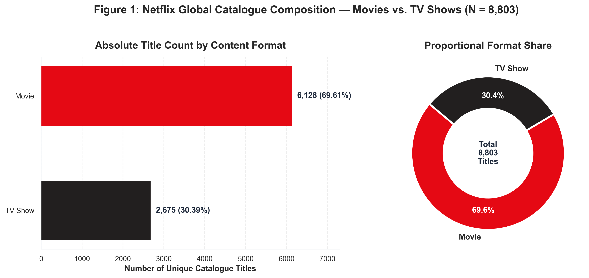

However, examining static totals obscures the dynamic trajectory of catalogue ingestion over time. Figure 2 plots the distribution of titles by original production `release_year` (1980–2021), while Figure 8 decomposes platform ingestion (`year_added` and `month_added`) across the expansion cycle.

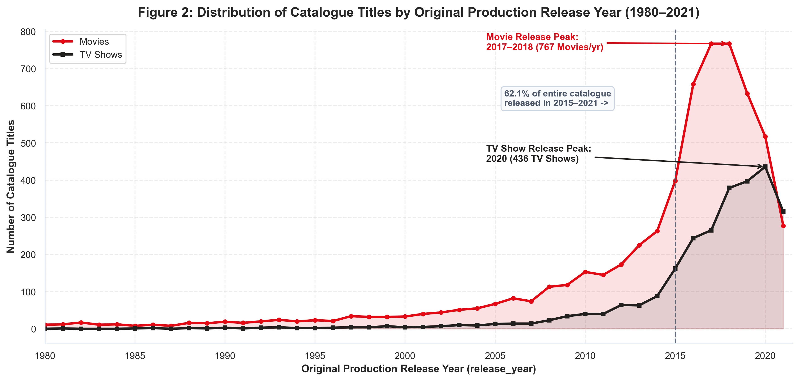

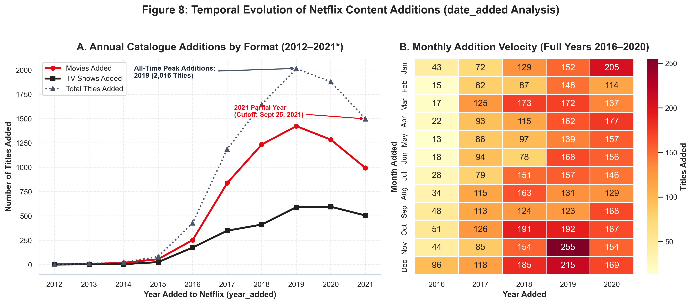

Three structural patterns emerge from comparing Figure 2 and Figure 8:
1. **Production Vintage Recency Bias:** Although the catalogue contains archival cinema dating back to 1925 (*Pioneers: First Women Filmmakers*), **$84.85\%$** of all titles were originally released in 2010 or later, and **$62.08\%$** were released between 2015 and 2021. The median production release year is **2017** (IQR: $2013–2019$) for Movies and **2018** (IQR: $2016–2020$) for TV Shows.
2. **Exponential Ingestion Wave (2015–2019):** Annual platform additions (`year_added`) expanded nearly 25-fold from **$82$ titles in 2015** ($56$ Movies, $26$ TV Shows) to **$429$ in 2016**, **$1,188$ in 2017**, **$1,649$ in 2018**, and an all-time peak of **$2,016$ titles in 2019** ($1,424$ Movies, $592$ TV Shows).
3. **Post-2019 Shift Toward Episodic Television:** When total annual additions moderated by $6.8\%$ in 2020 ($2,016 \rightarrow 1,879$ titles), the contraction occurred entirely within Movies ($1,424 \rightarrow 1,284$, $-9.8\%$), whereas **TV Show additions reached an all-time record of $595$ series in 2020** (and accounted for $33.7\%$ of all additions through September 25, 2021, up from $25.0\%$ in 2018). Monthly seasonality across complete calendar years (2016–2020, Figure 8B) peaks during Q4 holiday and mid-summer licensing refresh windows (July, October, November, and December) and troughs in February.

### 4.2 Acquisition Lag Dynamics: First-Run Originals vs. Library Licensing (RQ04)
To quantify the temporal gap between initial content production and Netflix platform ingestion, we analyze the distribution of acquisition lag $L_i = Y_{i,\text{added}} - Y_{i,\text{released}}$ across all $n = 8,779$ records with valid non-negative lag ($6,126$ Movies and $2,653$ TV Shows). Table 2 and Figure 12 summarize the parametric and non-parametric lag distributions by format.

**Table 2: Acquisition Lag ($L_i = Y_{i,\text{added}} - Y_{i,\text{released}}$) Distribution by Content Format**

| Content Format | Valid $n$ | Mean Lag (Yrs) | SD (Yrs) | Median ($Q_2$) | IQR ($Q_3 - Q_1$) | Same-Year ($L_i = 0$) | Recent ($1–2$ Yrs) | Mid-Window ($3–5$ Yrs) | Library ($6–10$ Yrs) | Archival ($11+$ Yrs) |
| :--- | :---: | :---: | :---: | :---: | :---: | :---: | :---: | :---: | :---: | :---: |
| **Movie** | 6,126 | 5.73 | 9.74 | 2.0 | 7.0 ($0–7$) | 30.40% | 27.18% | 13.30% | 11.62% | 17.50% |
| **TV Show** | 2,653 | 2.31 | 5.33 | 0.0 | 2.0 ($0–2$) | 51.98% | 23.71% | 11.65% | 7.76% | 4.90% |
| **Mann-Whitney $U$** | — | \multicolumn{9}{l}{$U = 10,354,434.5, \quad z = 21.05, \quad p = 2.62 \times 10^{-98}$ (Two-sided test of format difference)} |

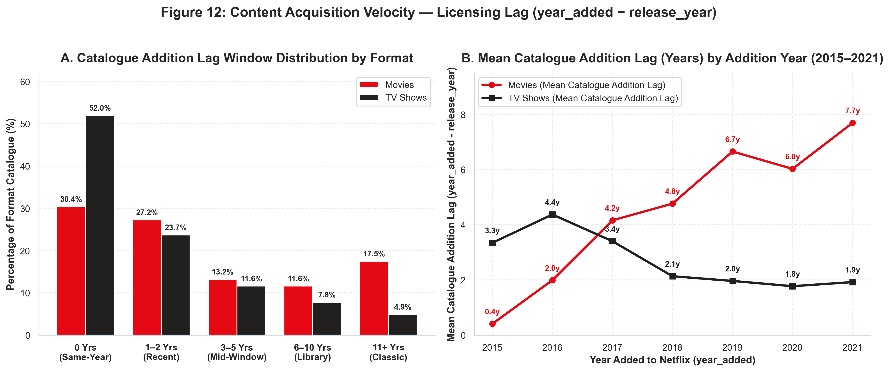

A two-sided Mann-Whitney $U$ test confirms that movie acquisition lags are stochastically larger than television acquisition lags ($U = 1.035 \times 10^7$, $p = 2.62 \times 10^{-98}$). Over half of all television series (**$51.98\%$**) enter the Netflix catalogue in the exact same calendar year they premiere (median lag $= 0.0$ years), reflecting Netflix's heavy investment in original and exclusive first-run serialized television. Conversely, while $30.40\%$ of Movies are same-year releases, nearly three-tenths (**$29.12\%$**) of all Movies are licensed back-catalogue films added **6 or more years** after theatrical premiere ($11.62\%$ in the $6–10$ year window; $17.50\%$ in the $11+$ year classic window). As shown in Figure 12B, mean Movie acquisition lag increased from $4.2$ years in 2017 to $7.7$ years in 2021 as Netflix supplemented original film premieres with large archival film packages to offset the withdrawal of recent studio output by competing studio-owned SVOD platforms.

### 4.3 Geographical Production Hierarchy and Regional Format Specialization (RQ02)
Across the $7,972$ titles with known country attribution ($90.56\%$ of the catalogue), $122$ distinct countries contribute $10,014$ country-title credits. The top three producing nations—the **United States ($3,689$ credits, $46.27\%$ of geo-tagged titles)**, **India ($1,046$ credits, $13.12\%$)**, and the **United Kingdom ($806$ credits, $10.11\%$)**—account for $69.51\%$ of geo-tagged presence. Table 3 and Figure 3 detail the format breakdown across the top 10 contributing countries.

**Table 3: Top 10 Content-Producing Countries and Format Specialization ($n = 7,972$ Known-Country Titles)**

| Rank | Country | Movie Credits | TV Show Credits | Total Credits | Share of Known-Country Titles (%) | Share of Total Catalogue (%) | Within-Country Movie Share (%) | Within-Country TV Show Share (%) |
| :-: | :--- | :---: | :---: | :---: | :---: | :---: | :---: | :---: |
| 1 | **United States** | 2,752 | 937 | 3,689 | 46.27% | 41.91% | 74.6% | 25.4% |
| 2 | **India** | 962 | 84 | 1,046 | 13.12% | 11.88% | **92.0%** | **8.0%** |
| 3 | **United Kingdom** | 534 | 272 | 806 | 10.11% | 9.16% | 66.3% | 33.7% |
| 4 | **Canada** | 319 | 126 | 445 | 5.58% | 5.06% | 71.7% | 28.3% |
| 5 | **France** | 303 | 90 | 393 | 4.93% | 4.46% | 77.1% | 22.9% |
| 6 | **Japan** | 119 | 199 | 318 | 3.99% | 3.61% | **37.4%** | **62.6%** |
| 7 | **Spain** | 171 | 61 | 232 | 2.91% | 2.64% | 73.7% | 26.3% |
| 8 | **South Korea** | 61 | 170 | 231 | 2.90% | 2.62% | **26.4%** | **73.6%** |
| 9 | **Germany** | 182 | 44 | 226 | 2.83% | 2.57% | 80.5% | 19.5% |
| 10 | **Mexico** | 111 | 58 | 169 | 2.12% | 1.92% | 65.7% | 34.3% |

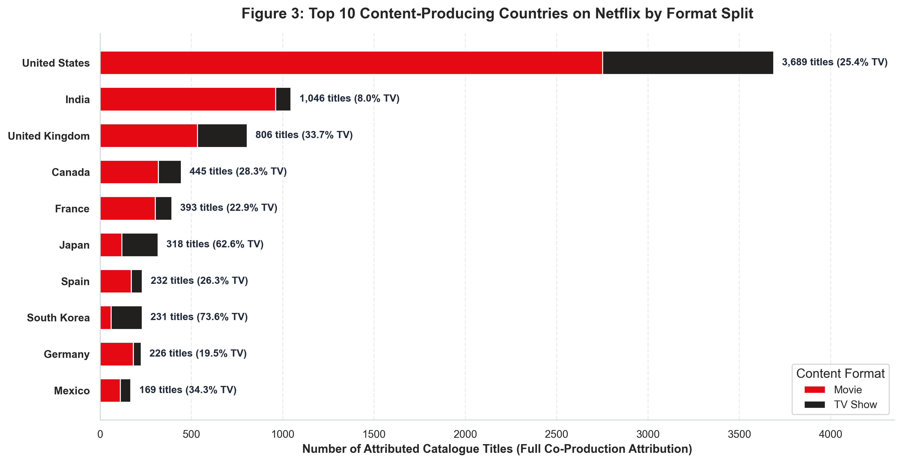

A $10 \times 2$ contingency table test across the top 10 countries rejects the null hypothesis of homogeneous format allocation across geographies:
$$\chi^2 = 687.68, \quad df = 9, \quad p = 3.07 \times 10^{-142}, \quad \text{Cramér's } V = 0.3017$$

While North American and European production hubs align closely with the global 70/30 baseline (United States at $25.4\%$ TV Shows; Canada at $28.3\%$; Spain at $26.3\%$; UK at $33.7\%$), Asian production hubs bifurcate into two opposing industrial models:
* **South Asian Cinematic Model (India):** India contributes $1,046$ titles, of which **$92.0\%$ ($962$) are feature films** and only $8.0\%$ ($84$) are television series, reflecting Netflix's aggressive licensing of theatrical Hindi, Tamil, Telugu, and Malayalam cinema.
* **East Asian Serialized Television Model (South Korea & Japan):** Conversely, **South Korea allocates $73.6\%$ ($170$ of $231$ titles)** and **Japan allocates $62.6\%$ ($199$ of $318$ titles)** of its Netflix catalogue footprint to episodic television series, driven by global demand for Korean dramas (*K-Dramas*) and Japanese *Anime Series*.

### 4.4 Genre Architecture and Multivariate Country-by-Genre Specialization (RQ03 & RQ07)
Across the $19,315$ exploded genre tags assigned to the $8,803$ titles, `International Movies` ($2,749$ titles, $31.23\%$ of total catalogue), `Dramas` ($2,425$, $27.55\%$), `Comedies` ($1,672$, $18.99\%$), `International TV Shows` ($1,350$, $15.34\%$), and `Documentaries` ($869$, $9.87\%$) lead overall frequency (Figure 4). Because Netflix partitions its taxonomy into format-specific labels (e.g., `Dramas` vs. `TV Dramas`) and Movies outnumber TV Shows $2.29 : 1$, Figure 10 stratifies genre frequency within each format separately.

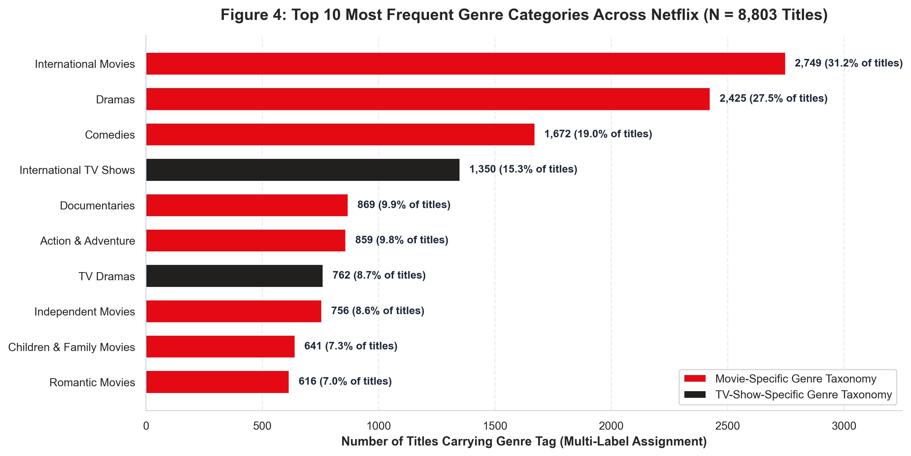

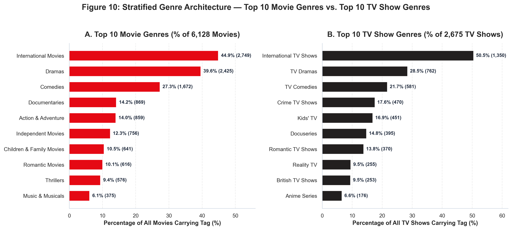

Within their respective formats (Figure 10), international programming represents **$44.86\%$ of all Movies** (`International Movies`, $n=2,749$) and **$50.47\%$ of all TV Shows** (`International TV Shows`, $n=1,350$). Beyond Drama and Comedy—which anchor both formats—television exhibits strong specialization in `Crime TV Shows` ($17.57\%$ of TV Shows), `Kids' TV` ($16.86\%$), `Docuseries` ($14.77\%$), `Romantic TV Shows` ($13.83\%$), and `Reality TV` ($9.53\%$).

To investigate how geographical origin conditions genre supply (RQ07), we perform an inner relational join between `df_countries` and `df_genres` on `show_id` and compute a row-normalized specialization matrix across the top 8 countries and top 8 genres (Figure 11).

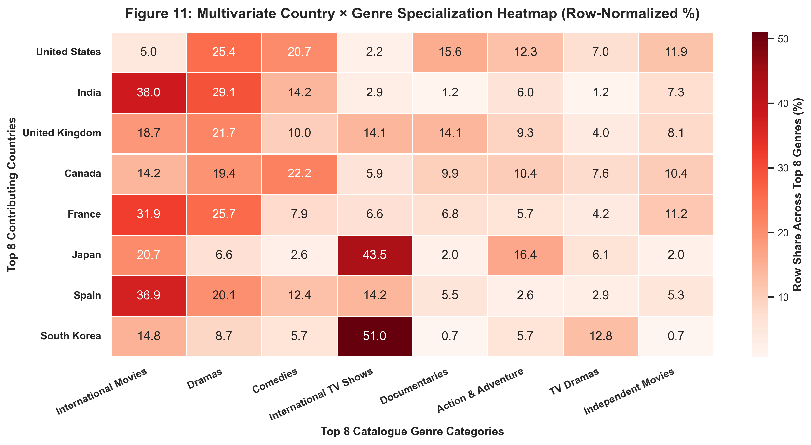

Row normalization ($P(\text{Genre}_j \mid \text{Country}_i)$ across the top 8 genres) eliminates marginal volume dominance by the United States and highlights distinct comparative advantages:
* **United States & United Kingdom:** Exhibit high relative specialization in `Documentaries` ($15.6\%$ of US top-8 genre tags; $14.1\%$ of UK tags) and `Independent Movies` ($11.9\%$ US; $8.1\%$ UK), compared to $\le 1.2\%$ documentary share in India and South Korea.
* **India:** Concentrates $81.3\%$ of its top-8 genre tags in just three categories: `International Movies` ($38.0\%$), feature `Dramas` ($29.1\%$), and feature `Comedies` ($14.2\%$).
* **South Korea & Japan:** Concentrate heavily in `International TV Shows` ($51.0\%$ South Korea; $43.5\%$ Japan), supplemented by `TV Dramas` in South Korea ($12.8\%$) and `Action & Adventure` (encompassing action anime) in Japan ($16.4\%$).

### 4.5 Distributional Analysis of Movie Runtimes and TV Show Seasons (RQ05)
We next examine the parametric and non-parametric distributions of continuous movie duration (`duration_min`, $n = 6,128$) and discrete television season counts (`seasons`, $n = 2,675$), illustrated in Figure 5 and Figure 6.

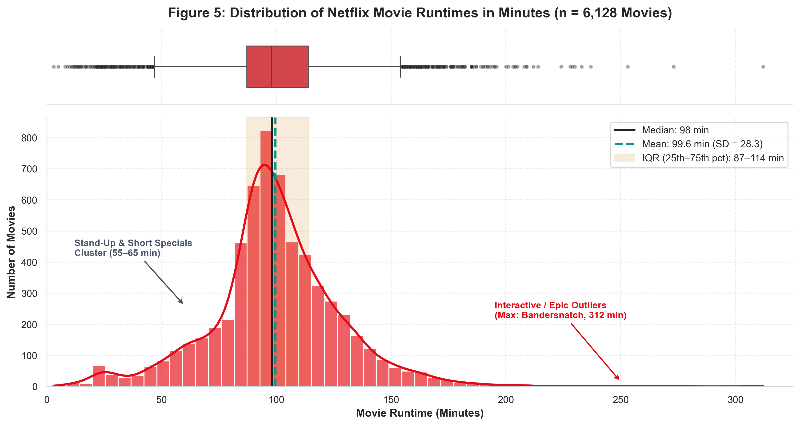

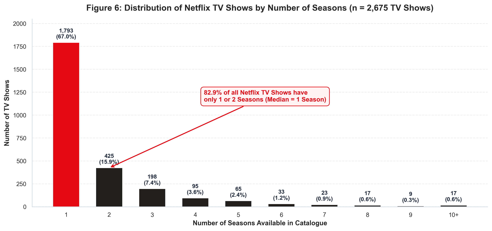

**Movie Runtimes (Figure 5):** Movie runtimes follow a unimodal distribution centered at a **mean of $99.56$ minutes** ($\text{SD} = 28.30$ min) and a **median of $98.0$ minutes**, with the middle $50\%$ of feature films ($\text{IQR} = Q_3 - Q_1$) spanning **$87.0$ to $114.0$ minutes** ($\text{IQR} = 27.0$ min; 5th–95th percentile: $52.0–147.0$ min). Applying Tukey's outlier criterion ($[Q_1 - 1.5\times\text{IQR},\; Q_3 + 1.5\times\text{IQR}] = [46.5,\; 154.5]$ minutes) identifies two structural tail populations:
* **Lower-Tail Outliers ($< 46.5$ min; $n = 249$, $4.06\%$ of Movies):** Composed of animated shorts (*Silent* at $3$ min; *Sol Levante* at $5$ min; *Cops and Robbers* at $8$ min; *Canvas* at $9$ min), short documentaries, and half-hour comedy specials. Together with one-hour `Stand-Up Comedy` specials (genre median $= 62.0$ min, IQR $= 11.0$ min) and `Children & Family Movies` (genre median $= 88.0$ min), these non-theatrical formats produce the secondary density shoulder visible between $55$ and $65$ minutes in Figure 5.
* **Upper-Tail Outliers ($> 154.5$ min; $n = 201$, $3.28\%$ of Movies):** Driven by two sources: (1) interactive branching narratives whose metadata records total multi-path video footage (*Black Mirror: Bandersnatch* at $312$ min; *Headspace: Unwind Your Mind* at $273$ min), and (2) classic and international cinema (`Classic Movies` median $= 112.0$ min; `International Movies` median $= 107.0$ min, including three-to-four-hour Egyptian theatrical plays and Indian epics).

**TV Show Season Counts (Figure 6):** In contrast to the bell-shaped distribution of movie runtimes, television season counts follow an extreme power-law / geometric decay ($\text{mean} = 1.76$ seasons, $\text{SD} = 1.58$, $\text{median} = 1.0$, $\text{IQR} = 1.0$ [$1–2$ seasons]). Exactly **$1,793$ of $2,675$ TV Shows ($67.03\%$)** consist of a **single season**, and **$425$ ($15.89\%$)** consist of **2 seasons**—meaning **$82.92\%$ of all television series on Netflix have $\le 2$ seasons**. Only $84$ series ($3.14\%$) span $6$ or more seasons, led by long-running licensed US broadcast syndication titles (*Grey's Anatomy* at $17$ seasons; *Supernatural* and *NCIS* at $15$ seasons; *Heartland* at $13$ seasons).

### 4.6 Maturity Rating Profiles and Taxonomic Harmonization (RQ06)
Across the entire catalogue ($N = 8,803$), adult and teen classifications dominate: `TV-MA` ($3,204$ titles, $36.40\%$) and `TV-14` ($2,160$ titles, $24.54\%$) together account for **$60.93\%$** of all listings, followed by `TV-PG` ($863$, $9.80\%$), `R` ($799$, $9.08\%$), and `PG-13` ($490$, $5.57\%$) (Figure 7).

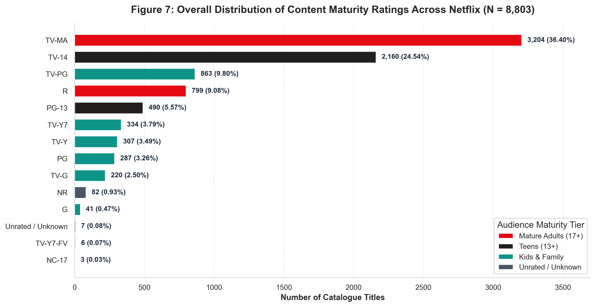

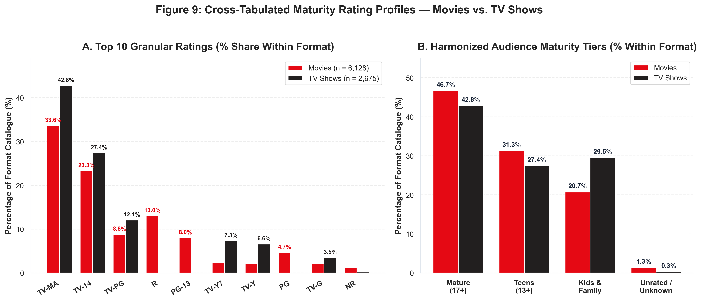

Comparing Figure 9A (granular rating codes) with Figure 9B (harmonized Audience Maturity Tiers) illustrates a critical methodological lesson in cross-tabulation analysis:
* **The Granular Taxonomy Paradox (Figure 9A):** In raw string terms, `TV-MA` accounts for $42.80\%$ of TV Shows versus $33.60\%$ of Movies, and `TV-14` accounts for $27.40\%$ of TV Shows versus $23.29\%$ of Movies. An analyst who inspects only `TV-MA` and `TV-14` would erroneously conclude that television series on Netflix skew more toward adult/teen audiences than feature films.
* **Resolution via Regulatory Harmonization (Figure 9B & Table 4):** That naive conclusion ignores the fact that $13.04\%$ of Movies carry the theatrical `R` rating and $7.96\%$ carry `PG-13` (codes that are virtually absent on TV Shows). When MPAA and TV Parental Guidelines are unified into our 4-tier Audience Maturity taxonomy (Table 4), the relationship reverses: **Movies skew higher in both Mature Adults ($46.67\%$ vs. $42.84\%$) and Teens ($31.28\%$ vs. $27.40\%$)**, whereas **TV Shows allocate a substantially larger share of their catalogue to Kids & Family programming ($29.50\%$ of TV Shows vs. $20.71\%$ of Movies)**. A $2 \times 4$ Chi-square test confirms that this difference is highly statistically significant ($\chi^2 = 98.16$, $df = 3$, $p = 3.86 \times 10^{-21}$, Cramér's $V = 0.1056$).

**Table 4: Contingency Table of Content Format by Harmonized Audience Maturity Tier ($N = 8,803$)**

| Content Format | Mature Adults (17+) (`TV-MA`, `R`, `NC-17`) | Teens (13+) (`TV-14`, `PG-13`) | Kids & Family (`TV-Y`, `TV-Y7`, `G`, `TV-G`, `PG`, `TV-PG`) | Unrated / Unknown (`NR`, `UR`, Null) | Row Total |
| :--- | :---: | :---: | :---: | :---: | :---: |
| **Movie** | 2,860 (**46.67%**) | 1,917 (**31.28%**) | 1,269 (**20.71%**) | 82 (**1.34%**) | 6,128 (100.0%) |
| **TV Show** | 1,146 (**42.84%**) | 733 (**27.40%**) | 789 (**29.50%**) | 7 (**0.26%**) | 2,675 (100.0%) |
| **Total Catalogue** | 4,006 (**45.51%**) | 2,650 (**30.10%**) | 2,058 (**23.38%**) | 89 (**1.01%**) | 8,803 (100.0%) |

---

## 5. Discussion, Limitations & Future Research Directions

### 5.1 Synthesis of Empirical Findings & Architectural Framework (Diagram 5.1)

**Diagram 5.1: Architectural Synthesis of the Netflix Global Catalogue Investigation**

```text
+-----------------------------------+     +------------------------------------+     +---------------------------------------------------+
| 1. RAW CORPUS AUDIT (N = 8,807)   |     | 2. DUAL-GRAIN 1NF ARCHITECTURE     |     | 3. EMPIRICAL SVOD PORTFOLIO MECHANISMS            |
|-----------------------------------|     |------------------------------------|     |---------------------------------------------------|
| * Cross-Column Recovery:          |     | * Title-Grain Base (N = 8,803):    |     | A. Regional Format Specialization (V = 0.3017):   |
|   3 shifted durations in 'rating' | --> |   6,128 Movies (69.61%)            | --> |    India: 92.0% Movies | S. Korea: 73.6% TV Shows |
| * Normalized Deduplication:       |     |   2,675 TV Shows (30.39%)          |     | B. Licensing Lag Asymmetry (p = 2.62e-98):        |
|   4 Unicode \xa0/case pairs       |     | * 1NF Country View (N_c = 10,014): |     |    TV: 52.0% same-year (Median lag = 0.0 yrs)     |
| * Format-Conditioned MAR Proof:   |     |   122 countries (16.55% co-prod)   |     |    Movies: 29.1% library >=6 yrs (Median = 2.0 y) |
|   Director null 91.4% TV vs 3.1%M |     | * 1NF Genre View (N_g = 19,315):   |     | C. Single-Season Decay & Maturity Harmonization:  |
|   (chi2 = 6,926.74, V = 0.8871)   |     |   42 genres | 4 Maturity Tiers     |     |    67.0% TV = 1 season | TV Kids 29.5% vs 20.7% M |
+-----------------------------------+     +------------------------------------+     +---------------------------------------------------+
```

### 5.1.1 Strategic Implications for SVOD Portfolio Management
The empirical findings of this study clarify three structural mechanisms governing global SVOD library construction:
1. **Bifurcated Internationalization Strategy:** Netflix does not acquire uniform format portfolios across international markets. Instead, its regional acquisition strategy mirrors local production comparative advantages—leveraging high-output theatrical film ecosystems in South Asia (India at $92.0\%$ Movies) to build feature volume while relying on East Asian television ecosystems (South Korea at $73.6\%$ TV Shows; Japan at $62.6\%$ TV Shows) for high-retention serialized storytelling.
2. **Complementary Roles of Movies and TV Shows Across Licensing Windows:** The highly significant divergence in acquisition lag ($p = 2.62 \times 10^{-98}$) demonstrates that television series function primarily as contemporary, first-run catalogue drivers ($51.98\%$ same-year ingestion), whereas feature films serve a dual role—combining same-year original releases ($30.40\%$) with deep library licensing ($29.12\%$ added $6+$ years post-release) to maintain breadth at lower marginal licensing cost.
3. **High Churn / Single-Season Concentration in Episodic Television:** The finding that $67.03\%$ of all television series in the catalogue consist of a single season (and $82.92\%$ have $\le 2$ seasons) reflects both the proliferation of self-contained limited series/docuseries and the economics of cost-plus streaming production, where escalating season-three talent residuals create a high renewal threshold after Seasons 1 and 2.

### 5.2 Methodological Scope Limitations
To ensure trustworthy interpretation, five dataset boundaries must be explicitly noted:
1. **Absence of Demand-Side Viewership Telemetry (Supply $\neq$ Demand):** The dataset contains zero metrics on subscriber viewing hours, completion rates, retention, or revenue. High catalogue share (such as `International Movies` at $31.23\%$) measures **supply allocation**, not audience consumption share.
2. **Cross-Sectional Survivorship Bias:** Because the snapshot captures active listings as of September 25, 2021, historical titles added between 2008 and 2018 whose licensing windows expired prior to late 2021 are unobserved.
3. **Right-Censoring of the 2021 Observation Window:** Data collection terminates on September 25, 2021 ($1,498$ additions across $8.8$ months, which annualizes to $\approx 2,040$ titles/year), omitting Q4 2021.
4. **Equal-Weight Co-Production Attribution:** In multi-country records ($16.55\%$ of geo-tagged titles), comma-separated country lists do not report financing percentages or primary creative control, and $831$ records ($9.44\%$) lack country tags entirely.
5. **Unit-of-Analysis Inequivalence (`1 Movie` vs. `1 TV Show`):** Counting rows treats an 8-minute short film and a 17-season, 380-episode television drama (*Grey's Anatomy*) as equivalent unit observations. In total runtime hours, episodic television represents a substantially higher share of the library than its $30.39\%$ title count share suggests.

### 5.3 Future Research Directions
Future empirical work should extend this baseline along three dimensions: (1) joining catalogue metadata with external episode-level runtime registries (IMDb / TMDB) to model library composition in **total streaming hours** rather than title counts; (2) linking our Country $\times$ Genre $\times$ Maturity supply matrices with Netflix's semi-annual *What We Watched* engagement reports (2023–2026) to compute **Supply-to-Consumption Efficiency Ratios**; and (3) applying transformer-based semantic embeddings (`sentence-transformers`) to title synopses (`description`) to uncover fine-grained thematic clusters beyond coarse `listed_in` genre tags.

---

## 6. Conclusion

This study demonstrated that rigorous exploratory data analysis of streaming media catalogues requires moving beyond surface-level descriptive charts to interrogate missingness mechanisms, schema integrity, relational atomicity, and multi-timestamp lag dynamics. By auditing and normalizing $8,803$ unique titles in Netflix's global catalogue, we established statistically robust evidence of format-conditioned MAR missingness in director credits ($V = 0.8871$), regional format specialization between South Asian cinema and East Asian serialized television ($V = 0.3017$), asymmetric licensing lag windows between first-run television and back-catalogue feature films ($p = 2.62 \times 10^{-98}$), and higher relative allocation to Kids and Family programming within episodic television once regulatory rating scales are harmonized ($V = 0.1056$).

---

## References

1. Bansal, S. (2021). *Netflix Movies and TV Shows Dataset* (`shivamb/netflix-shows`, Version 5). Kaggle. Public Domain (`CC0-1.0`). https://www.kaggle.com/datasets/shivamb/netflix-shows
2. Lobato, R. (2019). *Netflix Nations: The Geography of Digital Distribution*. New York University Press.
3. Lotz, A. D. (2022). *Netflix and Streaming Video: The Business of Subscriber-Funded Video on Demand*. Polity Press.
4. Rubin, D. B. (1976). Inference and missing data. *Biometrika*, 63(3), 581–592. https://doi.org/10.1093/biomet/63.3.581
5. Tukey, J. W. (1977). *Exploratory Data Analysis*. Addison-Wesley.
6. Wayne, M. L. (2022). Global streaming platforms and national television markets: Netflix in Israel and Spain. *Media, Culture & Society*, 44(2), 341–357.
